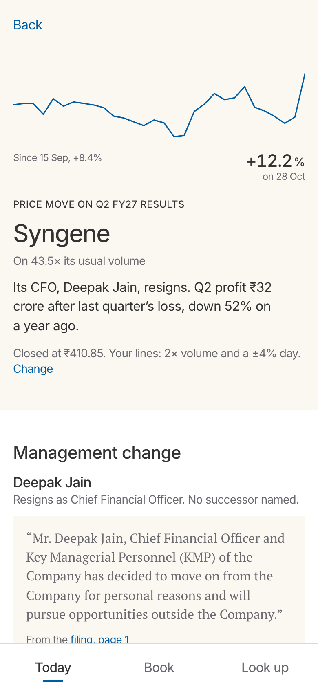
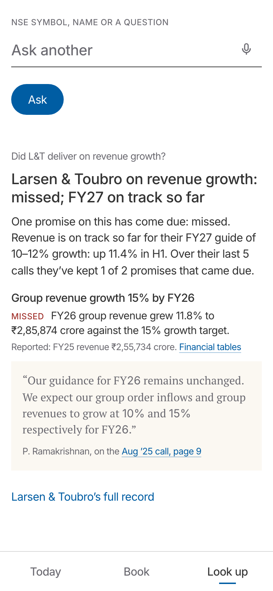

# FINN

FINN is a phone app for an investor who holds 15 to 20 stocks. You open it and it tells you how many things in your book need you today. Each one is held against what management promised on its earnings calls. When you've read them, you're done.

**Try it on a phone:** https://finn-ledger.vercel.app

<p>




</p>

## The point of view

An investor should spend a few minutes with FINN and then be done. A feed never tells you that you've seen everything, so you keep scrolling. FINN counts what needs you, shows you that, and puts the rest away in folds where you can still find it. I tried seven ways of using FINN against an investor's day, including chat and a dashboard. A short count you can finish won. Chat lost because an empty box hands the filtering back to you. The scoring is in [design/STAGE4_EXPLORE.md](design/STAGE4_EXPLORE.md) and the investor's day is in [docs/INVESTOR.md](docs/INVESTOR.md). The look is in [DESIGN.md](DESIGN.md).

## What it does

**Today (push).** All NSE filings and price moves across an 18-stock portfolio, for a window you pick. It's 24 hours by default and goes up to a month. The first screen is a count ("2 need you"), one sentence naming the companies and how far the filings run ("to 9:21 pm, 28 Oct"), the window, and the top of the first card. Each card is one event: the month's price line, the kind ("Q2 FY27 results and a new CFO"), the company, one sentence, and the line it crossed ("Past your ±4% and 2× lines, 43.5× volume"). Below the cards, two folds hold the rest: Worth a look, and Routine filings. The page ends on a blue band with a question for each company's next call, which you can copy. The band also links to Listen, which reads the day aloud, and to Change your lines.

**Your lines.** A sheet where you set what can interrupt you: a ±% day and a volume multiple. You also pick the kinds of filing that count (a CFO leaving, say). Move a line and Today recounts. With your permission, opening FINN on a newer snapshot raises a system notification for anything past your lines.

**The full view.** Read more grows a card into its page, and Back shrinks it into the same card at the same scroll. What comes first depends on the event:
- *Results*: revenue, EBITDA, PBT and PAT against last quarter and a year ago, parsed from the exchange's XBRL, plus the margin. If a compared quarter carries a tax credit or exceptional items, one line says so, so a −85% PAT isn't read as a collapse.
- *Management changes*: who joins or leaves, the person's background from the profile the company files, and a leaver's reason in the filing's own words with its page. A new CFO interrupts you. A new company secretary doesn't.
- *Unusual days*: the move, the volume against usual, a month of closes, and the filing that explains it if there is one.
- Deals, penalties and fund raises sized against the company's annual revenue. Under 0.5%, they drop to a one-line note.

Then **Against their word**: each promise that bears on the event, with its status (Missed, Gone quiet, Kept, Partly kept or Not due), what the filings showed, and management's quote with its page. Ask FINN sits under it with questions about this company.

**Book.** Your holdings under one row of counts across the book (4 missed, 17 gone quiet, 32 kept, 93 not due), each a filter, with the weakest word first. A company's page has its record ("1 of 2 promises kept"), the price line, every settled promise with what was delivered, and the ones still running. Questions for the next call come next. The numbers and a short case for and against sit in folds. Nothing comes from news, broker notes or the model's memory.

**Look up (pull).** One field for an NSE symbol, a company name or a question. Ask "Did L&T deliver on revenue growth?" and the answer comes back as promised against delivered, with its quote and page. A question about something no promise covers says "Not found in the filings". Promise questions are answered from the cached ledgers with no model call, so Look up keeps working when Gemini is out of quota. Any other NSE symbol runs live research: FINN reads the company's last five earnings calls and its filed results and builds its ledger in about a minute.

## Why it's built this way

I think an investor at a fund like ENAM doesn't need a better feed. They need to know what changed, whether it matters, and whether the people running their companies are still doing what they said. So every card on Today is held against a ledger of promises, and most of the push side is deciding what to leave out. The decisions and what I rejected are in [docs/DECISIONS.md](docs/DECISIONS.md).

## Architecture

```
                 after market close (pipeline/build_push.py)
NSE announcements ──► rules on NSE's subject (85% of filings, free)
                      └► flash-lite on the vague rest, reading the letter body
                 ──► results: NSE XBRL ──► Rev / EBITDA / PBT / PAT, QoQ, YoY (no model)
                 ──► management change PDF ──► flash-lite ──► names, roles, filed profile
                 ──► deals / penalties PDF ──► flash-lite ──► amount ──► % of revenue ──► tier
NSE bhavcopy (EOD, one file per day) ──► 45 sessions of close and volume
                                     └► push.json (static, served by Vercel)

                 per company (pipeline/build_ledgers.py, or live via /api)
screener.in tables ──► snapshot, 8 quarters, 6 years (arithmetic only)
NSE / company transcripts ──► flash-lite, one call per transcript ──► promises + quote + page
                          └► code checks every quote on its PDF page; misses are dropped
promises + filed numbers + latest call ──► flash (one call) ──► grades, questions, for/against
                                       └► evidence quotes checked again by code

phone (React, Vite) ──► static JSON for the portfolio and demo names
                    └► Ask on cached ledgers: matched in the browser, no model call
                    └► /api/sources, /api/call ×5 in parallel, /api/grade for any other ticker
```

Code map:
- `finn/` the engine. `classify.py` and `triage.py` hold the push policy. `ledger.py` holds the two prompts. `sources/pdf.py` has the quote check. `results.py` parses XBRL. `numbers.py` is all the arithmetic.
- `api/` three Vercel Python functions for live lookups. Each one stays well under the time limit; the phone runs them in sequence and shows progress.
- `pipeline/` batch builds and a local API server.
- `web/` the app. A small service worker keeps the last snapshot, so it opens from the home screen with no signal.
- `evals/` the three eval scripts and their last output.

## Models and cost

| Step | Model | Calls | Why |
|---|---|---|---|
| Classify vague filings | gemini-3.5-flash-lite | 1 per 20 filings | NSE's own subject settles most filings with rules for free; the model only sees the vague ones |
| Read management-change letters | gemini-3.5-flash-lite | 1 per filing | Extraction from a 2-page letter |
| Size deals and penalties | gemini-3.5-flash-lite | 1 per filing | Pull out one rupee amount; code does the comparison |
| Results numbers | none | 0 | Parsed from XBRL |
| Extract promises | gemini-3.5-flash-lite | 1 per transcript | Long but simple reading; every output is checked by code anyway |
| Grade promises, questions, for/against | gemini-3.5-flash | 1 per company | The one step that reasons across documents |

Measured from the usage log while building (`data/cache/usage.jsonl`, list prices from Aug 2026):

| Action | Tokens | Cost if billed |
|---|---|---|
| One company's full ledger (average of 19 built) | 94k | $0.09 |
| Push snapshot for 18 holdings, 30 days, 286 filings | 290k | $0.13 |
| Everything I ran while building, including reruns | 2.5M | $2.20 |

What I actually paid: nothing. It all runs on Gemini's free tier. Every model call is cached by prompt, so rebuilding after a code change is close to free.

The free tier's real limit is 20 `gemini-3.5-flash` requests a day. When that runs out, grading falls back to flash-lite and the company page says which model graded it. The portfolio and demo companies are prebuilt, so browsing the app never calls a model.

## Evals

All four run on real filings and transcripts. Details and caveats in [evals/README.md](evals/README.md).

| Eval | What it checks | Result |
|---|---|---|
| `run_classify.py` | Category and tier of 24 hand-labelled filings | Category 22/24 (92%), tier 21/24 (88%). One filing that should have interrupted didn't. |
| `run_results.py` | XBRL first cut against screener's independently compiled table, 18 companies | 62/70 numbers agree within 1%. The 8 that don't are definitions (e.g. TCI books its JV share below PBT; screener adds it). |
| `run_quotes.py` | The quote check against real and doctored quotes | Real 15/15 pass, small slips 15/15 pass. Changed numbers 10/10, added "not" 12/12 and stitched sentences 15/15 are caught. |
| `sample_grades.py` | 20 graded promises, checked by hand against the quote, evidence and numbers ([grades_review.md](evals/grades_review.md)) | 17/20 hold. One was marked kept before its deadline. One was a past action read as a promise. One was graded on evidence about a different deal (caught on a second look and corrected by hand). |

Twenty is a small sample. Eight companies were graded by flash-lite because the flash quota ran out mid-run. They are queued for a regrade when it resets.

## Run it locally

```
cp .env.example .env          # add a Gemini API key
pip install -r requirements.txt
python3 pipeline/build_push.py           # filings, results, people, EOD -> web/public/data/push.json
python3 pipeline/build_ledgers.py        # ledgers for the portfolio and demo names
python3 pipeline/dev_api.py &            # live lookups on :3001
cd web && npm install && npm run dev     # app on :5173
npm test                                 # what the screen says: percentages, dates, deadlines (Node 22.6+)
```

The portfolio is in `data/portfolio.json`.

## What I left out

- **Background push.** With permission, FINN raises a real system notification when you open it on a newer snapshot. It doesn't wake your phone on its own: that needs stored push subscriptions and a scheduler, and the data is built after the close anyway.
- **A live feed.** The push data is a snapshot built after market close, and the app says when it was built. The next step is a scheduled job, run from an Indian IP since NSE is picky.
- **Annual reports.** The ledger reads transcripts and filed numbers. Annual reports are 300 pages each; the right way in is chunking to the MD&A, related-party and contingent-liability notes. Not done.
- **BSE-only companies.** Everything keys off the NSE symbol.
- **Accounts and sync.** Settings and recent lookups live on the phone.
- **Charts.** A month of closes under each move and on the company page, and small bars for the numbers. I didn't want a terminal.

## Data sources

NSE corporate announcements, NSE integrated-filing XBRL, NSE daily bhavcopy, earnings-call transcripts filed on NSE or linked from screener.in, and screener.in's financial tables. All public, fetched politely with caching.
