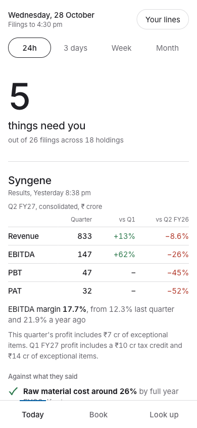
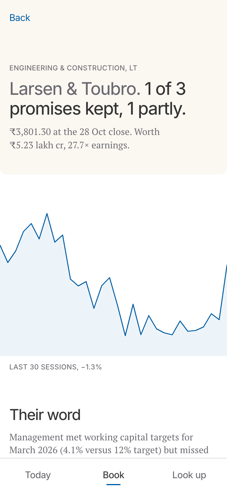
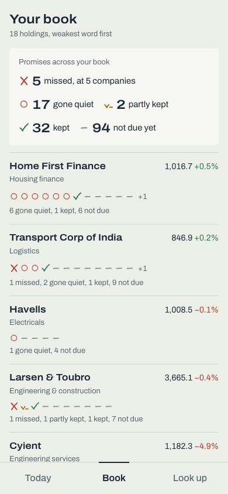

# FINN

FINN is a phone app for a long-only investor that keeps management to its word. It reads every earnings call, writes down what management promised, checks each promise against what the company later reported, and only interrupts you when something in your portfolio actually moved.

**Try it on a phone:** https://finn-ledger.vercel.app

<p>



</p>

## What it does

**Today (push).** Every NSE filing across an 18-stock portfolio, for a window you pick (24 hours by default). Most of it is folded. What's left:
- *Results*: revenue, EBITDA, PBT and PAT against last quarter and a year ago, parsed from the exchange's XBRL, and the promises that quarter settles.
- *Management changes*: who is joining and from where, taken from the profile the company itself files. A new CFO interrupts you. A new company secretary doesn't.
- *Unusual days*: volume or price beyond lines you set, and whether any filing explains the move.
- Deals, penalties and fund raises sized against the company's annual revenue. Under 0.5%, they drop to a one-line note.

**Look up (pull).** Type any NSE symbol (or the name of a company FINN has already read). FINN reads the company's last five earnings calls and its filed results, lists every promise that had a number and a date, and marks each one kept, partly kept, missed, gone quiet or not due yet. Each promise shows the quote and the page. Below that: questions to ask on the next call, the numbers (trajectory, margins, cash conversion, debt, working capital), and a short case for and against. Nothing comes from news, broker notes or the model's memory.

**Book.** Your holdings ordered by how well management has kept its word, weakest first, with a tally across the whole book.

## Why it's built this way

I think an investor at a fund like ENAM doesn't need a better feed. They need to know whether the people running their companies are still doing what they said. Every filing is either evidence for that or noise. So FINN is organised around a ledger of promises, and the push side is mostly about deciding what to leave out.

The decisions and what I rejected are in [docs/DECISIONS.md](docs/DECISIONS.md). How I got to the idea is in [docs/ideation.md](docs/ideation.md).

## Architecture

```
                 after market close (pipeline/build_push.py)
NSE announcements ──► rules on NSE's subject (85% of filings, free)
                      └► flash-lite on the vague rest, reading the letter body
                 ──► results: NSE XBRL ──► Rev / EBITDA / PBT / PAT, QoQ, YoY (no model)
                 ──► management change PDF ──► flash-lite ──► names, roles, filed profile
                 ──► deals / penalties PDF ──► flash-lite ──► amount ──► % of revenue ──► tier
NSE bhavcopy (EOD, one file per day) ──► 45 sessions of close and volume
                                     └► push.json (static, served by Vercel)

                 per company (pipeline/build_ledgers.py, or live via /api)
screener.in tables ──► snapshot, 8 quarters, 6 years (arithmetic only)
NSE / company transcripts ──► flash-lite, one call per transcript ──► promises + quote + page
                          └► code checks every quote on its PDF page; misses are dropped
promises + filed numbers + latest call ──► flash (one call) ──► grades, questions, for/against
                                       └► evidence quotes checked again by code

phone (React, Vite) ──► static JSON for the portfolio and demo names
                    └► /api/sources, /api/call ×5 in parallel, /api/grade for any other ticker
```

Code map:
- `finn/` the engine. `classify.py` and `triage.py` hold the push policy. `ledger.py` holds the two prompts. `sources/pdf.py` has the quote check. `results.py` parses XBRL. `numbers.py` is all the arithmetic.
- `api/` three Vercel Python functions for live lookups. Each one stays well under the time limit; the phone runs them in sequence and shows progress.
- `pipeline/` batch builds and a local API server.
- `web/` the app.
- `evals/` the three eval scripts and their last output.

## Models and cost

| Step | Model | Calls | Why |
|---|---|---|---|
| Classify vague filings | gemini-3.5-flash-lite | 1 per 20 filings | NSE's own subject settles most filings with rules for free; the model only sees the vague ones |
| Read management-change letters | gemini-3.5-flash-lite | 1 per filing | Extraction from a 2-page letter |
| Size deals and penalties | gemini-3.5-flash-lite | 1 per filing | Pull out one rupee amount; code does the comparison |
| Results numbers | none | 0 | Parsed from XBRL |
| Extract promises | gemini-3.5-flash-lite | 1 per transcript | Long but simple reading; every output is checked by code anyway |
| Grade promises, questions, for/against | gemini-3.5-flash | 1 per company | The one step that reasons across documents |

Measured from the usage log while building (`data/cache/usage.jsonl`, list prices from Aug 2026):

| Action | Tokens | Cost if billed |
|---|---|---|
| One company's full ledger (average of 19 built) | 94k | $0.09 |
| Push snapshot for 18 holdings, 30 days, 286 filings | 290k | $0.13 |
| Everything I ran while building, including reruns | 2.5M | $2.20 |

What I actually paid: nothing. It all runs on Gemini's free tier. Every model call is cached by prompt, so rebuilding after a code change is close to free.

The free tier's real limit is 20 `gemini-3.5-flash` requests a day. When that runs out, grading falls back to flash-lite and the company page says which model graded it. The portfolio and demo companies are prebuilt, so browsing the app never calls a model.

## Evals

All four run on real filings and transcripts. Details and caveats in [evals/README.md](evals/README.md).

| Eval | What it checks | Result |
|---|---|---|
| `run_classify.py` | Category and tier of 24 hand-labelled filings | Category 22/24 (92%), tier 21/24 (88%). One filing that should have interrupted didn't. |
| `run_results.py` | XBRL first cut against screener's independently compiled table, 18 companies | 62/70 numbers agree within 1%. The 8 that don't are definitions (e.g. TCI books its JV share below PBT; screener adds it). |
| `run_quotes.py` | The quote check against real and doctored quotes | Real 15/15 pass, small slips 15/15 pass. Changed numbers 10/10, added "not" 12/12 and stitched sentences 15/15 are caught. |
| `sample_grades.py` | 20 graded promises, checked by hand against the quote, evidence and numbers ([grades_review.md](evals/grades_review.md)) | 18/20 hold. One was marked kept before its deadline. One was a past action read as a promise. |

Twenty is a small sample. Eight companies were graded by flash-lite because the flash quota ran out mid-run. They are queued for a regrade when it resets.

## Run it locally

```
cp .env.example .env          # add a Gemini API key
pip install -r requirements.txt
python3 pipeline/build_push.py           # filings, results, people, EOD -> web/public/data/push.json
python3 pipeline/build_ledgers.py        # ledgers for the portfolio and demo names
python3 pipeline/dev_api.py &            # live lookups on :3001
cd web && npm install && npm run dev     # app on :5173
```

The portfolio is in `data/portfolio.json`.

## What I left out

- **Real push notifications.** The app shows what would interrupt you, but doesn't send it to your lock screen. Web push needs a service worker, stored subscriptions and a scheduler; I chose to spend the time on what gets pushed.
- **A live feed.** The push data is a snapshot built after market close, and the app says when it was built. The next step is a scheduled job, run from an Indian IP since NSE is picky.
- **Annual reports.** The ledger reads transcripts and filed numbers. Annual reports are 300 pages each; the right way in is chunking to the MD&A, related-party and contingent-liability notes. Not done.
- **BSE-only companies.** Everything keys off the NSE symbol.
- **Accounts and sync.** Settings and recent lookups live on the phone.
- **Charts.** Two small bar charts and a sparkline. I didn't want a terminal.

## Data sources

NSE corporate announcements, NSE integrated-filing XBRL, NSE daily bhavcopy, earnings-call transcripts filed on NSE or linked from screener.in, and screener.in's financial tables. All public, fetched politely with caching.
