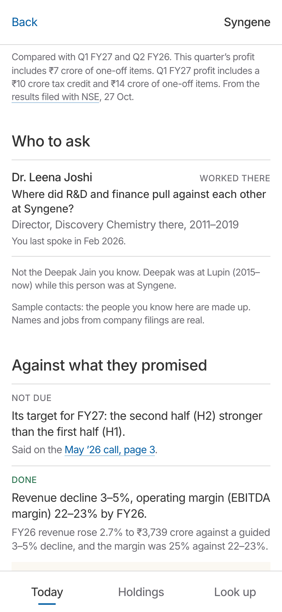

# FINN

FINN shows the few holdings that need a look today, and then it ends. Each comes held against what management promised, with the person you know who can explain it.

**Try it on a phone:** https://finn-network.vercel.app. It is a replay of the 28 Oct 2026 market close, and the investor's network is invented and labelled as such on screen.

<p>



</p>

## What it does

**Today (push).** Every NSE filing and end-of-day move across an 18-stock portfolio, for the window you pick, from a day to a month. The top counts the companies that need a look and names them. Each card is one event: the price move, what was filed, the alert levels it passed and the person you know to ask. Your alert levels are a move in a day, a multiple of the usual trading and the kinds of announcement that may interrupt; move one and the count follows. Below the cards, Worth a look and Routine announcements fold the rest, People you know lists what the network noticed, and the day ends on a band of questions for the next calls, each with who to ask first.

**The full view.** Read more opens one event whole:
- *Results*: revenue, EBITDA, PBT and PAT against last quarter and a year ago, parsed from the exchange's XBRL, with the margin, and a line when a compared quarter carries a tax credit or exceptional items.
- *Management changes*: who joins or leaves, in the filing's own words with its page, and the incoming person's background from the profile the company filed.
- *Unusual days*: the move, the volume against usual, a month of closes, and the filing that explains it if there is one.
- *Who to ask*: the contact best placed to explain it, why, and when you last spoke.
- *Against their word*: this year's guidance still running, and the last promise that fell due, with what was delivered, the verdict, and management's quote and its page.

Deals, penalties and fund raises are sized against the company's revenue: under 0.5% of a year's revenue they drop to a one-line note.

**Holdings and company (pull).** Holdings ranks the companies by how well each management has kept its word, under one bar of every promise that has come due. A company's page is its ledger: every promise with a number and a date, marked in plain words (Done, Partly done, Missed, No update, Not yet due or Can't tell yet), with the quote and its page. A call's shorthand is spelled out beside its letters: "loan-to-deposit ratio (LDR)", "return on equity (ROE)". Then questions for the next call, Who to ask, the numbers, and a short case for and against. Nothing comes from news, broker notes or the model's memory.

**The annual report.** One more fold on each company, read by rules from the FY26 annual report filed on NSE, never by a model. *The auditor*: whether the opinion was modified, each matter the auditor drew attention to, named by its note and the term the auditor defined, and whether that term comes up on the company's calls. UltraTech's auditor stresses penalties from the Competition Commission of India, with no provision made; neither ‘CCI’ nor ‘Competition Commission’ appears in its last five calls. *Contingent liabilities*: claims not acknowledged as debt, both years as printed, against a year's profit (Syngene's ₹531 crore is 1.7 years of profit). The closed row carries the verdict, every line links to its page, and a matter can add a question for the next call. KFin's filing is a cover letter, so its page says nothing was read.

**Look up.** Type a symbol, a name or a question. Promise questions ("Did L&T deliver on revenue growth?") are answered from the built ledgers with no model call. Any other NSE symbol is read live: FINN reads its last five earnings calls and the filed results and builds the ledger, the way the companies here were built offline.

**The Network.** It appears beside what it can explain, never on a screen of its own: a line on the card, Who to ask (or Who was there, for someone arriving) in the full view and on every company, Ask first in the end band, and People you know on Today. When filings say something together (control seats at one company, or one call that answers a question at each of several), it raises one card of its own on Today, last and outside the count of what needs a look. The person beside a question fits it: for a CEO, CFO or MD who left, someone who worked there and left over a year ago; for the numbers, someone at a competitor or a customer today, asked about their own seat. Where it can't tell whether a filing names someone you know, it asks (Same person or Someone else); the answer stays on the phone and every view is rebuilt from it. Typed into Look up, it answers directly:

| The brief's question | Ask FINN | It answers |
|---|---|---|
| Who should I call? | Who should I call about SRF’s tax notice? | Pooja Nanda, who ran SRF's taxation |
| Second-degree reach | Who knows the new MD of HDFC Bank? | The two people you know who were at ICICI Bank and ICICI Securities, with one question for each. The filing gives no years, so it says overlap is not known |
| Diligence on people | Brief me before I meet Home First | The new CFO's path as the filing lists it, three people you know on it and one from the trade it doesn't list, each with one question, and what to ask in the room |
| Expertise map | Who are my go-to people for specialty chemicals? | Dr. Anjali Rao first, then the others, each with their years in the field |
| Keeping the network warm | Who should I reconnect with? | People you haven't spoken to in a while, each with a fresh reason |

It also notices what you wouldn't, by joining what you'd never join by hand: a new CFO's listed employers with the people you know at each (the path, in the card's full view as Who was there); two small changes that are a pattern together (within two days Crompton's head of internal audit moved roles and its compliance officer resigned, and Push had folded one of the two); one contact who answers two of the month's questions; the only person you know who has worked inside a holding, when it has been years since you spoke, said on the path that already asks that person. And still: a contact named in a filing; a filing name that may be your contact, asked rather than assumed; a namesake who provably isn't; a cluster of senior exits. Every one is a rule on real filings, and nothing in the new ones reads a public profile. No model runs here. Matching is code, and a name alone never confirms a person. Details in [docs/NETWORK_CORE.md](docs/NETWORK_CORE.md).

**What's synthetic.** The investor, the contacts and every tie are invented, and the app says so wherever they appear: "Sample network: your contacts and their ties are made up. Names and roles from filings are real." A real executive in a filing carries only what the company filed: titles, dates, the stated reason and the brief profile filed with the appointment, which gives no years (`evals/run_security.py`, filed fields).

**Listen** reads Today aloud with the phone's own speech. With your permission, opening FINN on a newer snapshot raises a system notification for anything new past your alert levels.

**Your data.** A pill in the masthead, "Sample data, as of 28 Oct", and a row at the foot of Your alert levels open one sheet that says, in five short blocks:
- that this is sample data fixed at 28 Oct, with the book and the network invented and the filings real;
- what stays on this phone (listed from the one registry every storage call goes through, `web/src/storage.ts`), and what the server holds: your internet address for about ten minutes, to limit how often it is asked, and its host's log of each request, never what you sent, for an hour;
- what a model reads (public filings only, and what reading the demo's own companies shows the model's provider);
- where each fact comes from, and that FINN reads a filing as text to check, never as orders to follow;
- what doesn't work on this link, from the server's own answer, so Look up says reading a new company is off before you tap.

*Clear this phone* removes every FINN key and the saved copy. After one visit FINN opens with no signal. A real install keeps the row and loses the pill; each privacy block says what would change for real (ARCHITECTURE's [Security and privacy](docs/ARCHITECTURE.md#2-security-and-privacy)).

## Why it's built this way

I think an investor at a fund like ENAM doesn't need a better feed. They need to know what changed, whether it matters, whether the people running their companies are still doing what they said, and who they know who can explain it. A feed never tells you that you've seen everything, so you keep scrolling; FINN's day ends. I tried seven ways of interacting against an investor's day, including chat, voice, a copilot and a dashboard ([design/STAGE4_EXPLORE.md](design/STAGE4_EXPLORE.md), [docs/INVESTOR.md](docs/INVESTOR.md)). The decisions and what I rejected are in [docs/DECISIONS.md](docs/DECISIONS.md).

## Architecture


- **The data, kept apart** ([ADR](docs/adr/0001-three-kinds-of-data.md)). What companies file is read once for everyone, and code checks any model's reading. What you hold and who you know stays with code, unseen by any model. What you ask reaches a model only on no-training terms, never with your name or holdings, and isn't kept.
- **The app today.** Static files built after the close, and four small functions on Vercel, which do the live reads. The server trusts only what it fetched itself: it lists a company's calls on its own and connects only to public addresses.
- **The filing ledger** ([ADR](docs/adr/0002-ledger-is-the-queue.md)), not a company's promise ledger. Each NSE filing becomes an event, worked through resumable, fingerprinted steps: rules first, a model only where rules can't settle it, code checking the model. A whole-market day is in `evals/ingest_day.txt`.
- **Answering** ([ADR](docs/adr/0003-checked-workflow-bounded-agent.md)). Designed, not working on this link: a checked workflow that shows only whole sentences found on a call's own page, with code writing every number. A bounded agent is built as its escalation and stays off until a keyed run shows it helps.
- **The gate** ([ADR](docs/adr/0004-code-checks-and-evals-gate.md)). No prompt or model changes without passing `evals/gate.py`, and a CI workflow is written to run it on every pull request. It hasn't run on GitHub yet: this branch is one commit, with no pull request behind it.
- **The annual report** ([ADR](docs/adr/0006-annual-reports-by-rules.md)). Rules, not a model, read the auditor's reports and the contingent-liability note from pages cut out of each report and committed, so its evals run offline; a quote shows only if it is exact on its page, a figure only as printed.
- **Price reaction** ([docs/PRICE_REACTION.md](docs/PRICE_REACTION.md)). A year of every NSE filing and price audits which filings may interrupt you.
- **Cost.** About $0.10 to read a company; at list prices, about $60 a month in model calls to read every NSE company's filings and calls.
- **For real** ([ADR](docs/adr/0005-production-on-gcp.md)). Google Cloud in Mumbai: a public project, and a private one with no model and no way out.

The full section, with the data inventory, threats, the cloud plan and where it is weak: [docs/ARCHITECTURE.md](docs/ARCHITECTURE.md). How the app's snapshot is built today:

```
                 after market close (pipeline/build_push.py)
NSE announcements ──► rules on NSE's subject (211 of 286 filings, free)
                      └► flash-lite on the vague rest, reading the letter body
                 ──► results: NSE XBRL ──► Rev / EBITDA / PBT / PAT, QoQ, YoY (no model)
                 ──► management change PDF ──► flash-lite ──► names, roles, filed profile
                 ──► deals / penalties PDF ──► flash-lite ──► amount ──► % of revenue ──► tier
NSE bhavcopy (EOD, one file per day) ──► 45 sessions of close and volume
                                     └► push.json (static, served by Vercel)

                 per company (pipeline/build_ledgers.py, or live via /api)
screener.in tables ──► snapshot, 8 quarters, 6 years (arithmetic only)
NSE / company transcripts ──► flash-lite, one call per transcript ──► promises + quote + page
                          └► code checks every quote on its PDF page; misses are dropped
promises + filed numbers + latest call ──► flash (one call) ──► grades, questions, for/against
                                       └► evidence quotes checked again by code

phone (React, Vite) ──► static JSON for the portfolio and demo names
                    └► Ask on cached ledgers: matched in the browser, no model call
                    └► /api/sources, /api/call ×5 in parallel, /api/grade for any other ticker
```

Code map:
- `finn/` the engine. `classify.py` and `triage.py` hold the push policy. `ledger.py` holds the prompts. `sources/pdf.py` has the quote check. `results.py` parses XBRL. `numbers.py` is all the arithmetic.
- `api/` four Vercel Python functions: three for live lookups, one for network questions. Each one stays well under the time limit; the phone asks for the list of calls, then the calls, all at once, then the grading, and shows progress.
- `pipeline/` batch builds and a local API server.
- `web/` the app. A small service worker keeps the last snapshot, so it opens from the home screen with no signal.
- `evals/` the eval scripts and their last output.

## Models and cost

| Step | Model | Calls | Why |
|---|---|---|---|
| Classify vague filings | gemini-3.5-flash-lite | 1 per 20 filings | NSE's own subject settles most filings with rules for free (211 of 286 in the 28 Oct snapshot); the model only sees the vague ones |
| Read management-change letters | gemini-3.5-flash-lite | one per filing | Extraction from a short letter |
| Size deals and penalties | gemini-3.5-flash-lite | one per filing | Pull out one rupee amount; code does the comparison |
| Results numbers | none | none | Parsed from XBRL |
| Annual report notes | none | none | Read by rules from cut pages; every quote checked on its page |
| Extract promises | gemini-3.5-flash-lite | one per transcript | Long but simple reading; every output is checked by code anyway |
| Grade promises, questions, for/against | gemini-3.5-flash | one per company | The one step that reasons across documents |

Measured from the usage log while building (`data/cache/usage.jsonl`, list prices from Aug 2026):

| Action | Tokens | Cost if billed |
|---|---|---|
| One company's full ledger (average of 21 built) | 96k | $0.095 |
| Push snapshot for 18 holdings, 30 days, 286 filings | 290k | $0.13 |

What I actually paid: nothing. It all runs on Gemini's free tier. Every model call on public text is cached by prompt, so rebuilding after a code change is close to free; private text is never cached.

The free tier's real limit is the daily quota on `gemini-3.5-flash`. When that runs out, grading falls back to flash-lite and the company page says which model graded it. The portfolio and demo companies are prebuilt, so browsing the app never calls a model.

## Evals

The model evals run on real filings and transcripts; the network and security evals need no model and no network. Details and caveats in [evals/README.md](evals/README.md).

| Eval | What it checks | Result |
|---|---|---|
| `run_classify.py` | Category and tier of 24 hand-labelled filings | Category 22/24 (92%), tier 21/24 (88%). One filing that should have interrupted didn't, and two interrupted that shouldn't have. |
| `run_results.py` | XBRL first cut against screener's independently compiled table, 18 companies | 62/70 numbers agree within 1%. The 8 that don't are definitions (e.g. TCI books its JV share below PBT; screener adds it). |
| `run_quotes.py` | The quote check against real and doctored quotes | Real 15/15 pass, small slips 15/15 pass. Changed numbers 10/10, added "not" 12/12 and stitched sentences 15/15 are caught. Of 13 real quotes with several words swapped for synonyms, only 7 pass: strict by choice, since losing a real promise costs less than showing a quote management never said. |
| `sample_grades.py` | Twenty graded promises, checked by hand against the quote, evidence and numbers ([grades_review.md](evals/grades_review.md)) | 17/20 hold. One was marked kept before its deadline, which code now prevents (`run_recheck.py`). One was a past action read as a promise. One was graded on evidence about a different deal (caught on a second look and corrected by hand). |
| `run_recheck.py` | The ledger's rules in code, so a model's grade can't break them: a growth or margin target whose period hasn't ended is not due, a promise past its date with nothing said since is past due, a grade resting on a figure the results don't report is unmeasured, and no check ever adds a kept; on made-up rows, then the 22 committed ledgers | 20/20; a second pass over the ledgers moves nothing |
| `run_network.py` | The Network core: names, organisations, identity (84 invented namesakes), links, questions | 334/334; 0 false matches |
| `run_security.py` | The model key and error codes; limits; logs; the connect-time guard; the PDF fetch; what grade keeps; headers; that no invented profile year or unfiled profile field is shown; that private text is refused without paid terms and never cached; that answering tools take no URL, refuse private tools and keep nothing of a question; that the status op says only whether reading works, fetching nothing | 108/108 |
| `run_annual.py` | The annual-report readers against labels read by hand from 22 reports, half held out and labelled before the readers first ran on them; every quote exact on its page, every figure printed there; every modifying heading in each whole PDF accounted for | 37/37. Opinion and every emphasis right on 41 of 41 audit reports, no figure shown wrong. The first held-out run missed Sun Pharma's audit reports, whose heading the rules didn't know, and showed one wrong figure (SRF); a second pass fixed both, reported apart ([annual_result.txt](evals/annual_result.txt)). A clone prints 36/36: the remaining check compares each fixture with its report PDF, which the repo doesn't hold |
| `a11y.py` | axe-core's WCAG 2.2 A and AA rules at 390×844 on ten views (Today, an opened card, Holdings, a company and its annual report open, Look up and an answer, a network path, Your alert levels, Your data); every control at least 24 px; the keyboard to the sheet; reduced motion | 0 serious or critical on 10 of 10 views |
| `speed.py` | Three cold loads of a local preview on a throttled phone (150 ms round trip, 1.6 Mbps, CPU 4×), medians | First paint 1096 ms (was 1840 before the outline moved into the HTML), largest paint 2032 ms, the count settled 2514 ms; 123 KB of script gzipped |

The filing ledger, answering, agent, price-reaction, text-model and gate evals are in [evals/README.md](evals/README.md), with their counts.

Twenty is a small sample. Eight companies were graded by flash-lite because the flash quota ran out mid-run. They are queued for a regrade when it resets.

## Run it locally

```sh
cp .env.example .env          # add a Gemini API key
pip install -r requirements.txt
python3 pipeline/build_push.py           # filings, results, people, EOD -> web/public/data/push.json
python3 pipeline/build_ledgers.py        # ledgers for the portfolio and demo names
python3 pipeline/dev_api.py &            # live lookups on :3001
cd web && npm install && npm run dev     # app on :5173
npm test                                 # what the screen says: percentages, dates, deadlines (Node 22.6+)
```

The data the app reads is committed, so seeing it needs no key and no build: install the requirements, skip the `build_` lines, and run the rest. With no key the local server says reading a new company is off, as the link does. The `build_` lines rebuild the data, and they need the key.

The portfolio is in `data/portfolio.json`.

## What I left out

On purpose:
- **Background push.** With permission, FINN raises a system notification when you open it on a newer snapshot. Waking the phone on its own needs the native app the [production ADR](docs/adr/0005-production-on-gcp.md) describes: a web app can't take the silent push that keeps your holdings private.
- **A live feed.** The data is a snapshot of the 28 Oct close, and the app shows its date. For real, a scheduled job after the close, run from an Indian IP.
- **Accounts and storage.** Your alert levels, read state and identity answers live on the phone.
- **BSE-only companies.** Everything keys off the NSE symbol.
- **Real profiles.** For real, careers come by the contact's consent or from a licensed provider, never scraped ([docs/ARCHITECTURE.md](docs/ARCHITECTURE.md)).

Weak today:
- **The annual report is read in part.** Rules read the auditor's reports and the contingent-liability note; the business overview, segments and related parties aren't read, so there is no business snapshot. A claims figure shows only where the note prints a total, 8 of 21 reports: most list claims by head, and heads are never summed.
- **Some calls couldn't be read.** A transcript link that returns no PDF, a site that can't be reached, or a filing that is only a cover letter is skipped, and the company's page says "Could not be read" beside that call. All five of Eris Lifesciences' calls went that way, so it has no ledger; four of five did at Maruti Suzuki and at SRF, whose ledgers rest on one call each.
- **17 of 20 grades** held when I checked them by hand, a small sample ([evals/grades_review.md](evals/grades_review.md)).
- **Model steps the link doesn't run yet: one built and key-gated, one only designed.** A free question about a company, answered from the pages of its calls: the checked workflow and its guards are built and pass their offline checks against a stubbed model (`evals/run_answer.py`, 68/68; the right page in the top five for 17 of 20 questions, [ADR](docs/adr/0003-checked-workflow-bounded-agent.md)). It has not run against a real model and it isn't behind Look up, so on this link it is designed, not working. An investor's own question would also need a model on no-training terms. And a model reading the annual-report pages that list claims with no total: designed in its [ADR](docs/adr/0006-annual-reports-by-rules.md), not built, so those notes show the page and no figure.
- **Matching a filing's name to a contact is measured only on invented contacts,** 84 invented namesakes with no false match, never on a real contact list.

## Data sources

The brief's sources, and what FINN uses for each, all public and fetched politely with caching:
- **Price and volume:** NSE's daily bhavcopy, the exchange's own end-of-day file for every stock.
- **Announcements and filings:** NSE corporate announcements, and NSE's XBRL for results.
- **Fundamentals:** earnings-call transcripts filed on NSE or linked from screener.in, and screener.in's financial tables. FY26 annual reports filed on NSE, cut to the auditor's reports and the contingent-liability note, read by rules.
- **Network profiles:** synthetic and labelled; how it would be done for real is in [docs/ARCHITECTURE.md](docs/ARCHITECTURE.md).

## This repository

The repo's default branch, submission, is one commit, built from this branch's tree by `evals/ship.py`, so invented facts about real people from earlier versions stay out of public history; `main` keeps the October submission.
