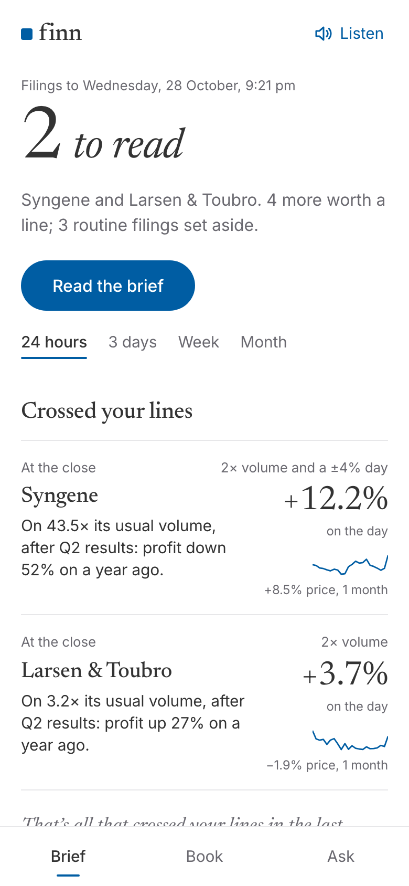
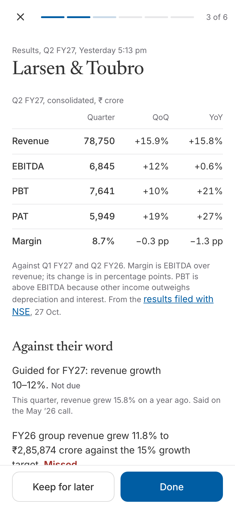
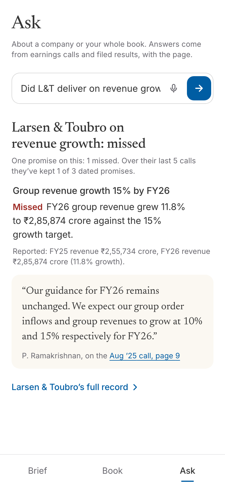

# FINN

FINN is a phone app for an investor who holds 15 to 20 stocks. Each morning it hands you the few things that changed in your book, holds each one against what management promised on its earnings calls, and tells you when you're done.

**Try it on a phone:** https://finn-ledger.vercel.app

<p>



</p>

## The point of view

FINN is a brief you finish. A feed never tells you that you've seen everything, so you keep scrolling. FINN's brief ends. You read the two or three items that matter, mark each one done or keep it for later, and it tells you you're up to date and how many routine filings it set aside. I tried seven ways of using FINN against an investor's day, including chat, voice, a copilot and a dashboard. The brief won because it ends. The scoring is in [design/STAGE4_EXPLORE.md](design/STAGE4_EXPLORE.md) and the investor's day is in [docs/INVESTOR.md](docs/INVESTOR.md).

## What it does

**Brief (push).** Every NSE filing across an 18-stock portfolio, for a window you pick: 24 hours by default, or 3 days, a week, a month. The top says how many things need you ("2 to read") and names them. Under it, **Crossed your lines** lists anything past a line you set (a ±% day, a volume multiple, a kind of filing), with the line printed on it. Tap the line to move it and the brief recounts behind the sheet. Below that come a few one-line notes, and the routine filings folded into a count.

**The reader.** "Read the brief" opens one item per screen, with Done and Keep for later at the bottom where your thumb is. Each kind of item leads with what you'd want first:
- *Results*: revenue, EBITDA, PBT and PAT against last quarter and a year ago, parsed from the exchange's XBRL, plus the margin. Then **Against their word**: this year's guidance still running, next to this quarter's growth, and the last promise that fell due, with what was delivered, the verdict, and management's quote and its page. If a compared quarter carries a tax credit or large exceptional items, one line says so, so a −85% PAT isn't read as a collapse.
- *Management changes*: who joins or leaves, and the incoming person's background from the profile the company files. If that filing has none, FINN takes it from the company's earlier filing on the same person and links it. A new CFO interrupts you. A new company secretary doesn't.
- *Unusual days*: the move, the volume against usual, a month of closes, and the filing that explains it if there is one.
- Deals, penalties and fund raises sized against the company's annual revenue. Under 0.5%, they drop to a one-line note.

After the last item the brief says you're up to date. Tomorrow starts where you left off, and anything new since your last visit is marked.

**Ask (pull).** On every item, and as its own tab. Type or say "Did L&T deliver on revenue growth?" and the answer comes back as promised against delivered: the verdict, the numbers, the quote and the page. Questions about the whole book work too ("Who missed a promise?"). Promise questions are answered from the cached ledgers with no model call, so Ask keeps working when Gemini is out of quota. Any other NSE symbol runs live research: FINN reads the company's last five earnings calls and its filed results and builds its ledger in about a minute.

**Book.** Your holdings, the most promises missed or gone quiet first, under one bar of every promise that has come due across the book. Each company's page lists every promise that had a number and a date, marked kept, partly kept, missed, gone quiet or not due yet, then the numbers, questions for the next call, and a short case for and against. Nothing comes from news, broker notes or the model's memory.

**Listen** reads the brief aloud with the phone's own speech. With your permission, opening FINN raises a system notification for anything new past your lines.

## Why it's built this way

I think an investor at a fund like ENAM doesn't need a better feed. They need to know what changed, whether it matters, and whether the people running their companies are still doing what they said. So every item in the brief is held against a ledger of promises, and most of the push side is deciding what to leave out. The decisions and what I rejected are in [docs/DECISIONS.md](docs/DECISIONS.md).

## Architecture

```
                 after market close (pipeline/build_push.py)
NSE announcements ──► rules on NSE's subject (85% of filings, free)
                      └► flash-lite on the vague rest, reading the letter body
                 ──► results: NSE XBRL ──► Rev / EBITDA / PBT / PAT, QoQ, YoY (no model)
                 ──► management change PDF ──► flash-lite ──► names, roles, filed profile
                 ──► deals / penalties PDF ──► flash-lite ──► amount ──► % of revenue ──► tier
NSE bhavcopy (EOD, one file per day) ──► 45 sessions of close and volume
                                     └► push.json (static, served by Vercel)

                 per company (pipeline/build_ledgers.py, or live via /api)
screener.in tables ──► snapshot, 8 quarters, 6 years (arithmetic only)
NSE / company transcripts ──► flash-lite, one call per transcript ──► promises + quote + page
                          └► code checks every quote on its PDF page; misses are dropped
promises + filed numbers + latest call ──► flash (one call) ──► grades, questions, for/against
                                       └► evidence quotes checked again by code

phone (React, Vite) ──► static JSON for the portfolio and demo names
                    └► Ask on cached ledgers: matched in the browser, no model call
                    └► /api/sources, /api/call ×5 in parallel, /api/grade for any other ticker
```

Code map:
- `finn/` the engine. `classify.py` and `triage.py` hold the push policy. `ledger.py` holds the two prompts. `sources/pdf.py` has the quote check. `results.py` parses XBRL. `numbers.py` is all the arithmetic.
- `api/` three Vercel Python functions for live lookups. Each one stays well under the time limit; the phone runs them in sequence and shows progress.
- `pipeline/` batch builds and a local API server.
- `web/` the app. A small service worker keeps the last snapshot, so it opens from the home screen with no signal.
- `evals/` the three eval scripts and their last output.

## Models and cost

| Step | Model | Calls | Why |
|---|---|---|---|
| Classify vague filings | gemini-3.5-flash-lite | 1 per 20 filings | NSE's own subject settles most filings with rules for free; the model only sees the vague ones |
| Read management-change letters | gemini-3.5-flash-lite | 1 per filing | Extraction from a 2-page letter |
| Size deals and penalties | gemini-3.5-flash-lite | 1 per filing | Pull out one rupee amount; code does the comparison |
| Results numbers | none | 0 | Parsed from XBRL |
| Extract promises | gemini-3.5-flash-lite | 1 per transcript | Long but simple reading; every output is checked by code anyway |
| Grade promises, questions, for/against | gemini-3.5-flash | 1 per company | The one step that reasons across documents |

Measured from the usage log while building (`data/cache/usage.jsonl`, list prices from Aug 2026):

| Action | Tokens | Cost if billed |
|---|---|---|
| One company's full ledger (average of 19 built) | 94k | $0.09 |
| Push snapshot for 18 holdings, 30 days, 286 filings | 290k | $0.13 |
| Everything I ran while building, including reruns | 2.5M | $2.20 |

What I actually paid: nothing. It all runs on Gemini's free tier. Every model call is cached by prompt, so rebuilding after a code change is close to free.

The free tier's real limit is 20 `gemini-3.5-flash` requests a day. When that runs out, grading falls back to flash-lite and the company page says which model graded it. The portfolio and demo companies are prebuilt, so browsing the app never calls a model.

## Evals

All four run on real filings and transcripts. Details and caveats in [evals/README.md](evals/README.md).

| Eval | What it checks | Result |
|---|---|---|
| `run_classify.py` | Category and tier of 24 hand-labelled filings | Category 22/24 (92%), tier 21/24 (88%). One filing that should have interrupted didn't. |
| `run_results.py` | XBRL first cut against screener's independently compiled table, 18 companies | 62/70 numbers agree within 1%. The 8 that don't are definitions (e.g. TCI books its JV share below PBT; screener adds it). |
| `run_quotes.py` | The quote check against real and doctored quotes | Real 15/15 pass, small slips 15/15 pass. Changed numbers 10/10, added "not" 12/12 and stitched sentences 15/15 are caught. |
| `sample_grades.py` | 20 graded promises, checked by hand against the quote, evidence and numbers ([grades_review.md](evals/grades_review.md)) | 17/20 hold. One was marked kept before its deadline. One was a past action read as a promise. One was graded on evidence about a different deal (caught on a second look and corrected by hand). |

Twenty is a small sample. Eight companies were graded by flash-lite because the flash quota ran out mid-run. They are queued for a regrade when it resets.

## Run it locally

```
cp .env.example .env          # add a Gemini API key
pip install -r requirements.txt
python3 pipeline/build_push.py           # filings, results, people, EOD -> web/public/data/push.json
python3 pipeline/build_ledgers.py        # ledgers for the portfolio and demo names
python3 pipeline/dev_api.py &            # live lookups on :3001
cd web && npm install && npm run dev     # app on :5173
npm test                                 # what the screen says: percentages, dates, deadlines (Node 22.6+)
```

The portfolio is in `data/portfolio.json`.

## What I left out

- **Background push.** With permission, FINN raises a real system notification when you open it on a newer snapshot. It doesn't wake your phone on its own: that needs stored push subscriptions and a scheduler, and the data is built after the close anyway.
- **A live feed.** The push data is a snapshot built after market close, and the app says when it was built. The next step is a scheduled job, run from an Indian IP since NSE is picky.
- **Annual reports.** The ledger reads transcripts and filed numbers. Annual reports are 300 pages each; the right way in is chunking to the MD&A, related-party and contingent-liability notes. Not done.
- **BSE-only companies.** Everything keys off the NSE symbol.
- **Accounts and sync.** Settings and recent lookups live on the phone.
- **Charts.** A month of closes under each move and on the company page, and small bars for the numbers. I didn't want a terminal.

## Data sources

NSE corporate announcements, NSE integrated-filing XBRL, NSE daily bhavcopy, earnings-call transcripts filed on NSE or linked from screener.in, and screener.in's financial tables. All public, fetched politely with caching.
