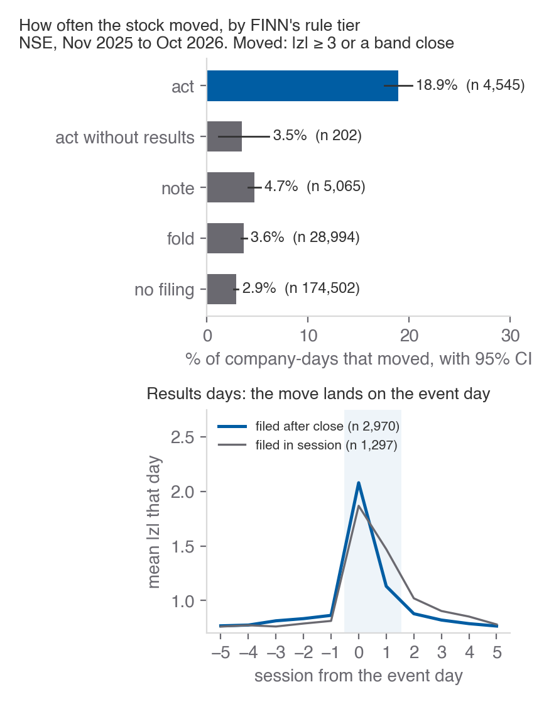

# Architecture, data security and privacy

## In 200 words

FINN tells investors what changed in what they hold. It keeps three kinds of data apart:
- **What companies file** is read once for everyone; code checks any model's reading.
- **What you hold and who you know** is seen by code alone.
- **What you ask** reaches a model only on no-training terms, without your name or holdings, and isn't kept.

Beside the app's 28 Oct snapshot, not yet feeding it, a ledger works each filing: rules, a model, code checking it.
- **A whole-market day.** On 12 Nov it took 987 filings from 574 companies. Rules settled 759. The other 228 wait for a key (₹21–33 of work); nothing was guessed.
- **A year of filings and prices.** Stocks moved 5.2× as often after filings FINN acts on as after routine ones, almost all on results. A 20-stock book gets 1.5 interrupts a week from rules alone, up to 12.6 if all awaiting a model did.
- **A gate** for every prompt or model change.
- **An agent**, bounded and tested offline, off until a keyed run shows it helps.

Production is designed for Google Cloud in Mumbai, its private project with no model and no way out.

## Before you read on

**Words used here.**
- *Act*, *note* and *fold* are a filing's tiers. Act interrupts you, note waits in Today under Worth a look, and fold is kept but folded away with routine filings.
- *Your lines* are the thresholds you set for what may interrupt you.
- *A key* is the Gemini API key a model call needs. None is set in this repo, so every model step waits; a *keyed run* is one made with a key.
- *The ledger* is the store of public filings and the steps run on them (ADR 2). A *drain* is one pass of its workers. A company's page in the app, its promises call by call, is a different thing, its *promise ledger*.
- A step's *fingerprint* is a hash of its prompt, schema, model and call. When it changes, the step re-runs, and the gate wants its eval.
- *The private project* is the cloud project that holds what you hold and who you know (§2).
- A *plane* is the side a tool sits on: public tools read filings, private ones touch what you hold or know. Answering refuses private tools, whoever asks.

![Solid parts run in this repo today; dashed parts are designed, not built yet. Everything companies file with the stock exchange (NSE) and each day's prices, fetched by hand for now with a year kept, become events and go through a read-and-checked step (rules first, an AI model only once it is given a key, code checking what it read) into facts. A price study looks back over the year and asks whether the stock moved after a filing FINN would alert you to; it tests the alert rules and never changes what the app shows you. Answering a question searches a company's own calls with investors and quotes what it finds; an AI model sees your question only if it can't train on it, never with your name or holdings, and FINN doesn't keep the question; the app has no screen for this yet. The app's snapshot, built by hand on 28 Oct from NSE and screener.in, is what your phone gets, and `/api` fetches a company live when asked; building it from the facts is designed. Below a line is your side, touched only by code: what you hold and who you know, invented for the demo, matched to public facts with no model, inside a locked space of its own in the cloud that is designed, fed by one read-only copy of public facts, also designed. Your phone sits outside both sides: public facts, and, as designed, only what's yours. Each box names the code that runs it.](img/architecture.png)

| Area | Running in this repo, with its check | Designed only |
|---|---|---|
| Ingestion | the ledger: each filing an event, worked by resumable steps (`finn/ingest/`, `run_ingest.py` 32/32); one whole-market day (`ingest_day.txt`); a year archived | a licensed feed; Cloud SQL as the queue |
| ML | a year of 181,790 filings and their prices audits the rules (§5, `run_reaction.py`); a text model on vague filings (`run_c2.py`) | a quarterly rerun |
| Answering | a checked workflow: quotes found on their page, numbers written by code (`run_answer.py` 68/68); a bounded agent, off by default (`run_agent.py` 27/27) | the agent's keyed run (ADR 3); the answering screen |
| Reliability | `evals/gate.py`: floors and a fingerprint for every model step, judged against the base branch (ADR 4); a CI workflow, not yet run on GitHub | the nightly live run, which needs a key |
| Privacy | model calls private by default, private ones never cached (`finn/llm.py`) | two GCP projects; a key per investor (ADR 5) |
| Cloud | the app on Vercel | GCP Mumbai (ADR 5); infrastructure code with the first project |

Decisions are recorded as ADRs in `docs/adr/`, each with its options, trade-offs and the number that would reopen it.

## 1. Data pipelines

### Running now
Every source is public, and the exchange comes first.
- **The app's snapshot.** `pipeline/build_push.py` reads the day's prices and filings into one static file. `pipeline/build_ledgers.py` reads a company's promises per call, and `/api` does it live. Both run by hand; the snapshot is from 28 Oct 2026.
- **The archive.** `pipeline/archive.py` fetches every NSE filing from 1 Nov 2025 to 28 Oct 2026 and every EQ and BE price from 1 Aug 2025, one gzip per day. It is resumable, polite (one request a second) and keeps a manifest of counts.
- **The ledger** (ADR 2).
  - `pipeline/ingest.py poll` stores each filing once as an event, with a new revision only when a fixed field changes.
  - `drain` works seven steps over it, each calling the function the app's build uses: `rules`, `read` (the model step `classify`, 20 filings a call), `results`, `people`, `explain`, `size` and `tier`.
  - A step parks, rather than fails, when there's no key or quota, and tier then proceeds as today's code does on a failure.
  - The whole-market day of 12 Nov fetched quarterly results for 50 of its 176 results filings, a cap that keeps requests to NSE small; the other 126 wait their turn (`ingest_day.txt`).
  - `evals/run_ingest.py` runs 32 checks on real archive rows: revisions, retries, leases, two drains and three polls at once, partial batches, the no-key path, fingerprints, backoff, a poisoned batch, drain order and replays. A clone without the 19 MB archive runs 31.

Statuses, leases and fingerprints

- **Statuses:**
  - done and pending; a pending run may carry `waiting` (sizing waits for an earlier quarter's results), which counts no try;
  - superseded: a newer revision of the filing replaced this one before it was read, so it is never sent to a model;
  - parked: `no_key`, `quota`, `terms`, each resuming when its cause clears;
  - blocked: can't tell whether it applies while an input is parked;
  - not_yet: XBRL lags. NSE is read again after a quarter of the filing's age, 15 minutes to 6 hours, and the run is dead as `no_xbrl` 60 days after the filing;
  - degraded: a fallback model answered. Re-asked fresh with a key, an hour apart, at most twice;
  - dead: `not_pdf` and `too_large` at once, anything else after 5 tries. A try is counted when it is claimed, so a worker that crashes uses one.
- **Leases.** A claim is a short transaction that sets a 30-minute lease token on one batch, whose worst case is about 10 minutes. Work happens outside it, and a completion writes only if its token still holds. One writer doesn't need this; two do, and a Cloud Run job started while the last still runs makes two. Check 16 runs two drains at once and pays each model step once.
- **Planned inputs only.** A run is worked only against the inputs it was planned for. If another drain is re-asking one of them, the claim is handed back and the run waits a minute. Worked at once, tier would say "not read", and a re-ask that answered the same would never run it again (check 24).
- **A poisoned batch.** `read` sends 20 filings in one call, and code checks each item of the reply against the schema's lists; an item off them is unread. If the whole reply can't be read, the batch is halved and each half asked once, following only a half that fails: one filing that breaks it is found in at most 11 calls, and the other 19 are read. If both halves fail, the model is the problem, so it stops at 3 calls, and a model that is down is asked once. No call starts that might outlast the lease; what is left counts its try and is read later (checks 25, 28–30).
- **Fingerprints.** A run's fingerprint covers its step's version, prompt, schema, model and fallback chain, and the fingerprint, status and output of each step it reads. A new read prompt re-runs read and what reads it, and nothing the rules settled; a re-ask that answers differently re-runs tier.
- **Facts** (a quarter's results, a company's revenue) carry their code's version in the key, so a new version makes a new fact. Revenue for sizing is the four quarters *before* the filing's, each as its own results filing gave it, if the ledger holds that filing and it was public by the filing's day. While a results filing it could use is still being read, sizing waits, so a capped or reordered drain sizes it the same. Otherwise it falls back to screener's table, which carries later restatements, and that is never stored as the day's fact. A replay sizes a filing as it could have been sized then (checks 22, 31).
- **Planning** works only events whose inputs were written since the step last planned them: a quiet drain of the 12 Nov day returns none in 0.02 s, against 0.8 s for working every event. The query still visits every event. On Postgres a completion marks the steps that read it, in the same transaction, and the planner works only marked events (ADR 2).

Sources: where each comes from, how it is stored and keyed

| Source | Fetched from | Refreshed | Stored as | Keyed by | For real |
|---|---|---|---|---|---|
| Prices | NSE bhavcopy | by hand | `push.json`; archive | symbol, ISIN, day | daily after close |
| Filings | NSE announcements | by hand | `push.json`; archive | filing id | every 15 min in market hours |
| Results | NSE XBRL | with the filing | `push.json` | symbol, quarter | with the filing |
| Fundamentals | screener.in | per company | `companies/*.json` | symbol | after each result |
| Earnings calls | NSE, then screener's BSE link | per company | `companies/*.json` | symbol, period | when filed |
| Annual reports | NSE (KFin's copy, and its BSE copy, is a cover letter) | per year, `pipeline/build_annual.py` | cut pages, `evals/fixtures/annual_pages.json.gz`; `annual/*.json` | symbol, PDF page, sha256 | yearly, with the AGM filing |
| Contacts' careers | invented | by hand | `data/network/investor.json` | contact id | monthly (see below) |

**Linking.** The NSE symbol ties a company's prices to its filings and promises, and the ISIN ties it across exchanges. A registry turns an employer's name into one organisation, keeping group companies apart. Identity calls two names *same*, *different* or *possible*, and a *possible* is asked, never assumed.

Profiles: today, and for real

Today there are 43 invented contacts. A real person named in a filing carries only what the filing states: titles, dates, the stated reason, and the brief profile SEBI's rules make the company file with an appointment, shown field for field and in its order. That profile gives no years, so FINN never says a contact and a filing person overlapped; it says they were both at an employer and that whether they overlapped is not known (`finn/network/links.py`; `evals/run_security.py`, filed fields). Until `network-loop` (14 Nov) the demo also held five invented profiles that dated real people's earlier jobs; they and the code that attached them are gone. Design only: in a real deployment a licensed professional-profile source could add years, each shown with its source and never where it contradicts the filing.

For real, a LinkedIn export gives only a name, a company, a position and a connection date. Careers would come from the contact's own consent or from a licensed provider under its terms, never from scraping. Profiles would refresh monthly, and matching re-runs when an employer changes.

One worked example of each, and how staleness and failures show

- **Symbol.** `HDFCBANK` ties the bank's prices to its filing naming Anup Bagchi as Managing Director and CEO from 27 Oct 2026, and to its promise ledger.
- **Registry.** "I-Sec" resolves to ICICI Securities. ICICI Bank shares its group but stays a separate employer, so a contact at ICICI Bank is not counted as Anup's colleague (`data/network/registry.json`).
- **Identity.** Rajat Shah in a CG Power filing is *same* as your contact: both records show CG Power. Deepak Jain in a Syngene filing is *different*: your Deepak was at Lupin at the time. Jigar Shah is *possible*. The name and line of work match, nothing else does, and your record of Jigar predates the change, so FINN asks. The answer (Same person or Someone else) stays on the phone. The server applies it only to a pair the engine itself asked about, settled before any work, so a made-up key builds nothing; it rebuilds every view with the function the pipeline uses, keeps one rebuild per answer set in memory and stores nothing (`api/network.py`, `finn/network/views.py`; `evals/run_security.py`, identity answers).
- **Staleness.** Today's cards carry the snapshot's date ("on 28 Oct"). An identity line says when a record is too old to show a change.
- **Failures.** A call that can't be read shows "not readable", and grading uses the rest. Server errors reach the phone as fixed codes, which the app turns into sentences (`web/src/lib.ts`, `plainError`).

### For real
Scheduled jobs on Cloud Run, the ledger in Cloud SQL as the queue, and a licensed feed behind the same `poll`, because NSE blocks cloud addresses and BSE-only companies are invisible to it (ADR 2, ADR 5).

## 2. Security and privacy

### Three kinds of data (ADR 1)

| | A model may read it | Where it lives for real |
|---|---|---|
| **Public filings** | yes, once for everyone; free terms allowed | the public project |
| **What you hold and who you know** | never: code only | the private project, no model, no egress |
| **What you ask** | only on paid terms, with no training on inputs, never with your name or holdings, not kept | a stateless service in the public project |

**In code today.** `finn/llm.py` treats text as private unless the caller says `public=True`. Every caller today sends public filings and says so. Private text is refused unless `FINN_MODEL_TERMS=paid`, and it is never cached (`run_security.py`, terms). Holdings and the network never import a model module (`run_security.py`, imports).

The demo today: what's real, why its file is public, what the server trusts

**What's real.** People named in filings appear as their company filed them, under a legal duty. FINN reads DPDP s.3(c)(ii) as placing that outside the Act; the fact that a given investor knows them is not. Invented: the investor, the contacts, every tie, and whatever a profile holds beyond the filing.

**Why the demo file is public.** `network.json` is public only because its people on your side, and every tie, are invented. `robots.txt` and `noindex` keep it out of search (`vercel.json`).

**The server trusts only what it fetched itself.** Signing each step's output for the phone to carry back was considered and cut: re-fetching the list of calls is cheap, and a signature can't make a forged promise true. `/api/call` takes a symbol and a period and finds the URLs itself. `/api/grade` keeps a call only if the server's own list holds its URL, and every connection must reach a public address (`finn/netguard.py`).

### For real (ADR 5)
- **Two projects.** The private one holds holdings, contacts, identity answers and lines. Vertex is disabled there, and nothing inside can call out: egress is denied, and a VPC Service Controls perimeter has no egress rules. Two things come in: the read-only export of public facts, and each investor's signed-in phone, answered with that investor's rows only.
- **Notifying with no egress.** The private project can't reach a push service, so it never does. When an act filing lands anywhere in the market, the public project wakes every enrolled phone with a push that carries nothing. Each phone then asks the private API what is new for its own book, and notifies only if something crossed its investor's lines. The wake-up depends on the market alone, so it says nothing about what anyone holds. A web app can't take a silent push (it must show a notification for each), so this needs the native app ADR 5 describes; until then there is no push.
- **Erasure by key.** Each investor's rows, caches and exports are encrypted with a data key wrapped by that investor's KMS keys, one in each region. Destroying both erases every copy, backups included.
- **What is read can reveal interest.** Public text carries no one's name, but which texts reach a model can. The demo reads only its holdings' filings and calls, and Look up reads whatever symbol is typed. For real, the ledger reads every filing and every company's calls whatever anyone holds, so what reaches the model says nothing about an investor, and a symbol looked up is answered from that market-wide reading, never read on demand (ADR 1).
- **Sign-in and staff.** The firm's sign-in. Staff access goes through groups, with data-access audit logs.
- **Consent.**
  - *The investor* agrees item by item, before anything is read: the book from the depository, the contacts from their own export. Each consent records its purpose and its day, is listed in the app, and can be withdrawn there. Withdrawal deletes the item; closing the account destroys the key. Requests to see and correct are in the same place.
  - *A contact never agreed to anything.* So FINN holds only what the investor's own export says of them (a name, an employer, a position, the day they connected), shows it to that investor alone, sends it to no model, and never joins one investor's contacts to another's. A career comes only by the contact's own consent or from a licensed provider under its terms. A contact who asks is told what is held and is removed, and a suppression list keeps a later import from bringing them back.
  - *Whether the firm may hold an investor's contacts at all under the DPDP Act is counsel's call before launch.* The design above is the narrowest one to put to them.

Data inventory

| Item | Source | Where today | Where for real | Kept | Model sees |
|---|---|---|---|---|---|
| Holdings: which companies you own | invented: a demo book of 18 | `data/portfolio.json`, shipped in `push.json` | the private project, encrypted per investor, from the depository with consent | while the account lasts | no |
| Investor's career and schools | invented | `data/network/investor.json` | the private project, encrypted per investor | while the account lasts | no |
| Contacts: names, how known, last met | invented | the same file | the same | while the account lasts | no |
| Contacts' careers | invented | the same file | consent or a licensed provider | 12 months after last use | no |
| People named in filings | NSE filings | `push.json`, `network.json` | the public project's facts | as filed | yes, the filing letter |
| Identity answers | the investor | sent with a request, never stored (`api/network.py`) | the private project | while the account lasts | no |
| Lines and read state | the investor | the phone's local storage | the phone, synced to the private project | while the account lasts | no |
| Question text | the investor | answered in the browser or by `/api/network`, with no model | the answering service, held in memory only | not kept | only on paid terms, with no name or holdings |
| Server logs | Vercel | codes, error types and frames, never a question (`run_security.py`, logs) | the firm's log store | 1 hour on Hobby; 1 month for real | no |
| Caller's IP address | the connection | in each function instance's memory, for the rate limit only (`finn/webapi.py`, `Limiter`) | the edge firewall | forgotten at the first request after its 10-minute window closes, swept at most once a minute (`run_security.py`, limits) | no |

Threats

| Threat | Status today | Test |
|---|---|---|
| A forged grade: the phone sends invented calls | stopped for URLs: a call the server didn't list is dropped, and periods come from the server. Forged promise text misleads only its sender; evidence quotes are checked on a page the server fetched | `run_security.py`, grade |
| The server made to fetch an internal address | stopped: only listed URLs are fetched; each redirect hop is checked; every connection must reach a public IPv4 address, resolved once and connected to directly | `run_security.py`, guard and pdf |
| The model key leaks | stopped: it travels in a header, never a URL, and errors are fixed codes. For real there is no key: workload identity | `run_security.py`, key |
| Private text sent on free terms by mistake | stopped: private is the default, and refused without paid terms, before any request | `run_security.py`, terms |
| Strangers spend the model quota or compute | capped by the free tier's daily quota and a per-IP limit on call and grade | `run_security.py`, limits |
| A filing that instructs the model | bounded: output is schema JSON, quotes must be on the page, numbers come from code. In a batch, an index read twice is left unread, so one filing can't pose as another. The read's line, questions, bull and bear are model text nobody checks, and the company page says so beside each | `run_quotes.py`; `run_security.py`, inject |
| The wrong person matched | capped: 0 false matches across 84 invented namesakes | `run_network.py` |
| Someone else reads a network | none today: one invented network, public on purpose. For real, stored per investor in the private project, with row-level security on the investor and the matcher under its own service account (ADR 5) | |
| Real names found through search | capped: `robots.txt`, `noindex` on `/data/` | `run_security.py`, search |

### On the phone

**The app says ADR 1 where the investor is.** A pill in the masthead, "Sample data, as of 28 Oct", and a lasting row at the foot of Your lines open *Your data* (`web/src/Trust.tsx`): the demo day, what stays on this phone, what a model reads, where each fact comes from and that a filing is read as text, never as instructions, and what doesn't work here. Its counts and dates are read from the served files. What it lists as kept on the phone comes from `web/src/storage.ts`, the one registry every storage call goes through; `web/test/storage.test.mjs` fails on a direct storage call or an undeclared key anywhere else. Whether reading a new company works comes from the server: `/api/sources` with `{"op":"status"}` answers only `{live}`, fetches nothing and spends none of the live-reading budget (`run_security.py`, status), so Look up says reading is off before the tap. *Clear this phone* removes every FINN key and cache, and the worker keeps the first visit so FINN opens with no signal (`flows.py`).

**Untrusted input.** Text from outside reaches FINN in five ways, and none of them can give it orders. Nothing below is a new defence; marking each filing as data inside the classify prompt waits on a keyed re-validation (Where this is weak).

| Input | What reads it | What bounds it | Check |
|---|---|---|---|
| A filing letter or a call transcript | a model, once for everyone | the answer must fit a fixed schema; a quote not found on its page is dropped; results figures come from the exchange's XBRL, read by code; a model's one-line summary of a vague filing links to the filing, and a company's read and questions are labelled as the model's on its page | `run_quotes.py`; `run_security.py`, inject |
| An annual report's pages | no model: rules (`finn/annual.py`, ADR 6) | it can only fill fixed sentences and question templates from fields parsed off a page; a quote is shown only if it is exact on its cited page; the page renders it as text | `run_annual.py` |
| A filing the Network joins | no model: rules | it can only pick among the fixed question templates in `engine.py`; names and titles are printed as filed | `run_network.py` |
| A typed question | no model on this demo: the phone, or `/api/network` | it picks among answers built from the ledger and the network, never a prompt; 300 characters on the phone, 64 KB at the server | `run_security.py`, limits |
| What the phone sends `/api/grade` | the server | it re-lists the company's calls and keeps only those it fetched itself | `run_security.py`, grade |

## 3. LLMs and agents

**Models.** Two Gemini models: flash-lite for bulk reading, and flash once per company to grade promises. About $0.10 reads a company, and a whole-market day of filings $0.24–0.38. A model never sees anything about you, does arithmetic, matches a person to a contact, or puts a quote on screen that isn't on its page. The model that actually answered is recorded, so a fallback is never mistaken for the model asked (`llm.scope`).

Each model step, its measured cost, and the whole market

| Step | Model | Calls | Measured cost | Code checks after |
|---|---|---|---|---|
| `classify`: vague filings | `gemini-3.5-flash-lite` | rules settle 211 of 286 | these three: $0.13 for 286 filings | category and tier from fixed lists |
| `people`: management changes | `gemini-3.5-flash-lite` | 1 per letter | | a quote is shown only if found on its page |
| `explain`: deals and penalties | `gemini-3.5-flash-lite` | 1 per filing | | code sizes it against revenue |
| `promise_extract` | `gemini-3.5-flash-lite` | 1 per transcript | about $0.007 | every quote found on its page, or dropped |
| `promise_grade` | `gemini-3.5-flash` | 1 per company | about $0.05 | evidence quotes checked on the page again |

About $0.10 reads a company: it averages $0.095 over 21 built (`companies/*.json`); the step split comes from their totals by model.

**Efficiency.** Routing: flash-lite does the bulk; flash runs once per company, because grading reads across documents. That split is a judgement, not a measurement: the history's one regrade changed the prompt and mixed models across companies, so it compares nothing cleanly. Measuring it means both models on one prompt over the 20 hand-reviewed grades, with a key. Caching: by prompt, public text only. Chunking: 6 pages tell a transcript from a cover letter; a call is read to 60 pages.

**The whole market, measured.** On 12 Nov, a day of 987 filings, the parked model work comes to 157–246 calls, $0.24–0.38 (₹21–33). That is an estimate: the snapshot's mean of $0.0015 a call, read counted per batch of 20, and explain's share a range, since it depends on whether read's line comes back empty (`evals/ingest_day.txt`).

**Answering a question** (ADR 3). A fixed workflow runs BM25 search over the last four calls' pages, then the top 5 pages, then one flash-lite call, then code checks.
- **Evidence, not prose.** A quote must be on its cited page, or the page either side, word for word. The screen shows the page's own text, as the whole sentences the quote sits in, so a quote that stops before "not", "crore" or "bps" is shown with them. A number is looked up by code, which writes the sentence. One failed item turns the answer into "Not in the calls I read."
- **Whole sentences only.** A page break or a blank line can cut a sentence in two, and the tail of "we do not think that…" reads as its opposite. So what is shown must end in a full stop, start as a sentence does, and not follow text left unfinished; page headers and footers between are stepped over. Of 13,153 sentences in the 549 checked-in pages, 319 are refused this way.
- **The company's words only.** A quote from a turn the moderator introduced as a question is refused: an analyst restating guidance isn't the company giving it. No speaker's name is shown yet (see "Where this is weak").
- **Tools** sit in a registry with planes. Private ones are refused, none takes a URL, and every result is marked as filing text.
- **Measured offline:** the labelled page is in the top 5 for 17 of 20 questions written before search existed, and every doctored answer is rejected. Answer quality needs a key (`run_answer.py --live`).

**Orchestration and agents.**
- **The ledger is FINN's orchestration** (ADR 2): dependent steps, retries, leases and fingerprints, resumable anywhere.
- **The agent is built, and off.** When the workflow finds nothing, a planner on flash picks tools from the same registry, and code bounds it: 6 steps, 10 tool calls, 60,000 tokens, no repeated call. The token budget is a ceiling: every try is counted, and a step or retry that might not fit isn't sent. Refusals go back as codes. A quote must be found on a page it read, by the workflow's verifier. It can follow a lead into another company's calls, and an item from there is headed with that company.
- **Tested offline with scripted planners** (`run_agent.py`, 27 checks): a looping planner stops at 6 steps, 25 calls asked at once run 10, a step over budget isn't sent, a true quote from an unread page is rejected, and no key reads as unavailable. Each bound was broken on purpose to see its check fail.
- **It stays off (`FINN_AGENT=1` turns it on) until a rule written before any number exists passes:** on the 26 questions it must add 4 net correct answers (half the workflow's misses where it misses fewer than 8, and never fewer than 2), give at most 1 false answer on the 6 unanswerable, and cost at most 3× the workflow. `run_answer.py --live --agent` computes it, and a person judges the answers.

**Reliability and evaluation** (ADR 4). `evals/gate.py` is the merge gate.
- **Offline floors:** security, network, ingest, answering and the agent in full; quotes at 74 of 80; the price study inside its interval.
- **Fingerprints** cover each model step's prompt template, schema, model and fallback chain, read from the call itself with every argument that changes what the model is asked: `classify`, `people`, `explain`, `promise_extract`, `promise_grade`, `answer` and `agent`. A model call in `finn/`, `api/` or `pipeline/` that no step owns is red. Each names what can validate it, and any change is red until that passes. A step with no validator yet may be accepted, with who, when and why recorded; a validated one can't be. The two models are named in code and nowhere else, so no environment variable changes one past the gate.
- **In a pull request** what is validated, the floors and the list of evals come from the base branch's `gate.json`, so editing it by hand passes nothing. An unvalidated step that changed needs `--accept`'s new record of who and why, and stays a skip. A dropped eval, floor or step is red; a floor may rise, never fall; a changed validated step passes only by a live run in that job. The gate can't guard its own code: a change under `evals/` or `.github/`, or to the model client, is for a code owner to read (`.github/CODEOWNERS`). Requiring that review, and required reviewers on the key, are repository settings, written down in ADR 4 and not yet set.
- **CI** is written to run the gate and the claims check on every pull request, and the live gate nightly once the key is a secret. It hasn't run on GitHub yet, since the public branch is one commit with no pull request behind it; its steps pass on a clean export of HEAD. The page text the evals read is checked in, so they run where NSE is blocked, and an eval that tries to fetch a page fails. A clone prints 10 pass, 0 fail, 8 skip: the six unvalidated steps, the one check that needs the 19 MB archive, and the one that compares each annual-report fixture with its PDF.
- **Its first catch:** a quotes eval that had drifted with the data it sampled.

## 4. Cloud

### Running now

| What | Where today | Why |
|---|---|---|
| The app | Vercel, static, service worker | opens offline |
| Data | static JSON in `web/public/data` | a dated snapshot needs no database |
| Four functions | Vercel Python: sources, call, grade, network | each within its time limit |
| Model | Gemini API, free tier | public text only |
| Model cache | `/tmp` per instance (`finn/config.py`) | cheap |
| Key | a Vercel environment variable | never sent to the phone |

Headers let the page load code only from FINN's own origin, and use the microphone only for voice questions (`vercel.json`).

### For real (ADR 5)
- Google Cloud in `asia-south1` (Mumbai), with recovery in `asia-south2` (Delhi).
- Cloud Run jobs and Cloud SQL as the ledger and queue in a public project; the overlay in a private project with no model and no egress.
- A month at whole-market scale is about $1,300 at list prices. Per-investor keys, one in each region (about $611), and the two databases (about $480) lead; the keys are the price of erasure that reaches backups. Every model line together is under $200 (ADR 5, with its assumptions marked).
- AWS, Kubernetes, Pub/Sub and staying on Vercel were each considered and rejected, with the reasons in ADR 5.

## 5. Price reaction

A year of every NSE filing (181,790, Nov 2025 to Oct 2026) and every price asks one question: do the filings FINN interrupts you for move the stock? A *company-day* is one company on one trading day. A stock *moved* when its return over the filing day and the next, less the market's, was at least three standard deviations, or it closed at a price band. The method and the statistics are in `docs/PRICE_REACTION.md`.
- **Act against fold.** On filing days FINN's rules mark act, the stock moved 5.2× as often as on days they fold (95% CI 4.7–5.7).
- **That is results.** Leaving results out, it's 1.0× (95% CI 0.3–1.7), on 202 company-days: there the rules do no better than fold. Most of those act filings wait on a model's reading (who left, how big the deal) before their tier is final, so that audit needs a key.
- **Interrupts.** A 20-stock book from the 500 most traded companies that file with NSE gets 1.5 rule-settled act days a week (90th percentile 1.7), and 12.6 (90th percentile 15.1) if everything that needs a model came out act.
- **Misses.** Against a day with no filing, three quiet kinds moved stocks more often than act filings outside results did: investor presentations (note) 2.9×, monitoring agency reports (fold) 2.5×, orders (note) 2.3×. But 0 of 13 survive Benjamini–Hochberg, the correction for testing 13 kinds at once, so no rule changes yet; investor presentations are the first to review.
- **A text model** reads NSE's one-paragraph summary on 17,694 vague filings, trained on earlier months and tested on later ones, scores a PR-AUC of 0.076 against 0.077 for the subject line alone (higher is better; a coin scores 0.059). Scored on the same days, the summary adds nothing measurable to the subject line. Whether the letter does is untested. The 19,850 company-days waiting on a model's reading moved 5.0% of the time, against 3.6% for fold.
- **Coverage.** 98.6% of filings matched a price, and the study stops below 97%.
- **What it changes.** The study never reorders Today. It changes what FINN claims.

## Where this is weak

1. **The app is a replay.** It shows a snapshot built by hand on 28 Oct. The ledger runs beside it and doesn't feed it yet: the views reading its facts are designed (dashed in the diagram), not built.
2. **Outside results, the market can't tell FINN's act tier from fold.** That's 1.0× on 202 days. The rest of act waits on a model's reading, and no keyed run has audited it (§5).
3. **No key, so model quality isn't measured live.** Classify is validated on 24 filings from October. People, explain, extraction, grading, answering and the agent are unvalidated, and the gate prints them as skips. Extraction and grading have only a hand review of 20.
4. **The eval sets are small**: 24 filings, 80 quote cases and 26 questions. The questions and their labels were written by the coding agent and no person has checked them yet, which the keyed run waits on. They catch large regressions only: on one run, a classifier truly 85% accurate clears the 21-of-24 floor half the time, and one at 80% a quarter of the time. People and explain have no labelled set of their own.
5. **Production is designed, not run.** No GCP project exists and there is no infrastructure code. The perimeter, the per-investor keys and the push that carries nothing are on paper, and the push needs a native app, and the infrastructure prices are assumed (ADR 5). Whether flash-lite is served from Mumbai is unconfirmed (ADR 1).
6. **The ledger is SQLite**, tested with two writers but never under load, and its source is a scraped exchange site.
7. **The offline gate sees what it fingerprints, nothing more.** A model changed behind the same name passes it until the nightly live run has a key. For every step but classify, the fingerprint covers the call, not the code that fills the prompt. Classify's covers its requests as built, so marking each filing as data, against injection, changes them and waits on classify's keyed re-validation.
8. **A quote carries no speaker.** Answering refuses a quote from a questioner's turn where the moderator introduced the questioner, which 26 of the 28 checked-in calls do; in the other two the check does nothing. It doesn't name who spoke: page furniture such as "ISIN:" looks like a turn's start, and a wrong name is worse than none. Naming speakers needs each call's list of participants, and comes before the answering screen.
9. **The annual report is read in part, by rules written on 11 reports.** A claims figure shows only where the note prints a total, 8 of 21 reports. Auditor recall rests on the three dev companies with an emphasis of matter and a sweep of every whole PDF, since the held-out half had none. The first held-out run missed one heading and showed one wrong figure; both were fixed in a second pass on the same half, so the second pass is not a held-out number. Related parties and the business overview aren't read (ADR 6).

## For the team

What any change must meet before merge. The gate (`python3 evals/gate.py`) runs all of it.
- **A model step:**
  - its output is checked by code: schema, fixed lists, quotes on their page, numbers from code;
  - its prompt, schema and model are fingerprinted;
  - it names its validator in `gate.py`: an eval with a floor, or until one exists an accepted change with its reason (people and explain wait on sets a person labels, since labels a model writes for its own eval aren't ground truth);
  - it records the model that answered, and parks rather than fails without a key or quota;
  - it reads public text, or says why it may read private text (ADR 1).
- **A tool** names its plane, takes no URL, validates its arguments against the server's own lists, and caps and marks its result.
- **A source** has its terms written down, is fetched politely, is keyed by NSE symbol and carries the ISIN, and is stored once as events with revisions.
- **A decision** that someone could reasonably reverse gets an ADR: at least two rejected options, and the number that would reopen it.

Disagreements are settled by running the eval, not by argument.
