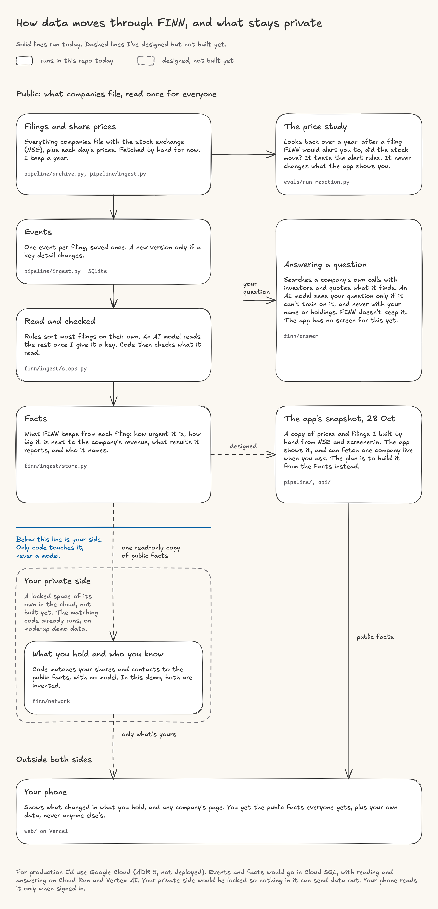

**To:** assessment@enam.com
**Subject:** IIT Kanpur – Founding AI Engineer - 2027

Hello,

Here is FINN, my submission.

- **App, on a phone:** https://finn-network.vercel.app, a replay of the 28 Oct close, marked Sample data. Its network is invented and labelled.
- **Code:** https://github.com/vedant-22/finn. Its default branch is one commit; `main` holds my October entry.
- **Build history:** attached, with a guide, [BUILD_HISTORY.md](BUILD_HISTORY.md). **Diagram:** attached.

It opens on "2 of your companies need a look today". The first is Syngene, "+12.2%". Its CFO has resigned, and its July to September "profit was ₹32 crore after a loss the quarter before, down 52% from a year earlier." It has passed both your alert levels, and FINN names someone you know to ask: Dr. Leena Joshi, who ran discovery chemistry there.

I didn't want to build another feed. FINN shows you the few holdings that need a look today, checks each against what management promised, then ends. In the 30 days to 28 Oct the 18 holdings filed 286 times, and FINN would have interrupted you for 43. I tried seven ways to interact before choosing this one ([DECISIONS](DECISIONS.md)).

Try Read more on Syngene, lower a level under Change alert levels, then open Holdings.

**What I built**

*Push* is the Today screen. Open a card for its results from XBRL and the promises they touch.

*Pull* is a company's page, which is its ledger: each promise with a number and a date, its verdict (Done, Missed, No update), its quote and page. Rules also read the annual report's auditor and contingent-liability notes and quote each page. UltraTech's auditor stresses Competition Commission penalties that its five calls never mention. The Look up tab answers questions from the ledgers with no model call, and reads any other NSE symbol live from its last five calls. Four companies outside the holdings have ledgers.

*The Network* has no screen of its own; a person appears beside what they can explain. Ask "Who knows the new MD of HDFC Bank?" and it names the two people you know who were at ICICI Bank and ICICI Securities. It won't guess an overlap, because the filing gives no years. "Brief me before I meet Home First" gets the new CFO's career as filed, with three people you know on it.

It also notices what you wouldn't. Two exits from Crompton's audit and compliance seats, one marked routine, make a pattern. One call to Meera Krishnan answers a question at Home First and one at HDFC Bank, so FINN raises a card. A name alone never confirms a match; when unsure, FINN asks. All 334 of 334 checks pass, with no false match across 84 invented namesakes.

**The network profiles**

Everything on your side is synthetic: the investor, 43 contacts and every tie. A real executive in a filing carries only what the company filed, with no years. For real I'd use a LinkedIn export (name, company, position, date), with careers by consent or from a licensed provider, never scraped, and kept 12 months after last use.

**Architecture**

*Data pipelines.* After the close, NSE's filings, XBRL results and daily prices become static files. Calls and fundamentals come per company from NSE and screener.in, linked by symbol.

*Security and privacy.* Public filings may reach a model. What you hold and who you know never do; only code works on them. A question reaches a model only on no-training terms, without your name or holdings. A filing is untrusted input, read as text and never as instructions, and model-written text is labelled. Tap Sample data to see this. For real I'd add firm sign-in, logged staff access, consent, and erasure by destroying the investor's key.

*LLMs and agents.* The models ran when the snapshot was built. `gemini-3.5-flash-lite` reads and `gemini-3.5-flash` grades once per company (flash-lite graded eight). Code does the arithmetic. It costs about $0.10 to read a company at list prices. A free-form question about a company, answered only from its calls, is designed but not in the app: its checks pass against a stand-in model, and it hasn't run against a real one. A bounded agent stays off until a live run shows it helps.

*Cloud.* Today it's a static app and four Python functions on Vercel, with no database and the key only on the server. For real I'd use Google Cloud in Mumbai to keep data in India: a public project, and a private one with no model and no way out. More in [ARCHITECTURE.md](ARCHITECTURE.md).

**Decisions and trade-offs**

- The promise ledger is the spine of Push and Pull.
- Code checks every quote against its page, catching a changed number or an added "not".
- Results come from XBRL, not a model: within 1% of screener on 62 of 70 numbers.
- A deal under 0.5% of a year's revenue gets only a one-line note.

**Left out on purpose:** background push (a web app can't take the silent push that keeps holdings private), accounts and storage, BSE-only companies and real profiles.

**Weak today.** There's no business snapshot or related-party note. Contingent-liability figures show only where the note prints a total, 8 of 21 reports (a model for the rest is only designed). I checked a small sample by hand, and 17 of 20 grades held. Name matching is tested only on invented contacts.

**Where I'd take it next.** I'd make the ledger the firm's memory: every analyst's call notes checked against the same promises, so a question from one call waits for the next to answer it.

**How I worked with the tools.** I directed Claude Code from written specs. Each task was a plan critiqued by three model reviewers, then a build that had to pass its evals. A reviewer once caught invented years on real executives, and I deleted them ([BUILD_HISTORY.md](BUILD_HISTORY.md)).

Thanks for reading.

Vedant Tiwari
IIT Kanpur · vedant22@iitk.ac.in
