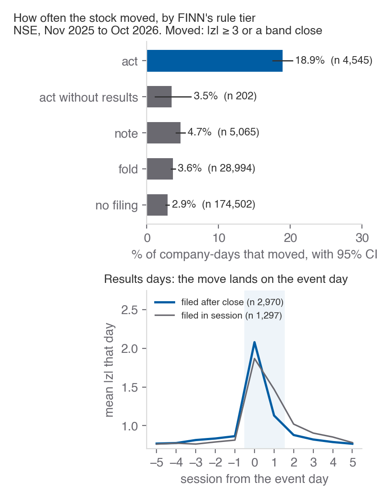

# Price reaction: does what FINN interrupts you for move the stock?

This takes a year of every NSE filing (181,790, from 1 Nov 2025 to 28 Oct 2026) and every EQ and BE price, matched by NSE symbol and every ISIN the symbol traded under (179,180 of the filings, 98.6%).
- Code: `pipeline/build_reaction.py`, `evals/run_reaction.py`, `evals/run_c2.py`.
- Numbers: `evals/reaction_result.txt`, `evals/c2_result.txt`.

## The answer
- **On filing days FINN's rules mark act, the stock moved 5.2× as often as on days they fold (95% CI 4.7–5.7).** That's 4,545 act company-days against 28,994 fold.
- **Almost all of that is results.** Leave results out and it's 1.0× (95% CI 0.3–1.7), on 202 company-days. Outside results, the market's reaction can't tell the rules from fold. The reason is that almost every other act filing waits on a model before its tier is final: who left, or how big the deal is. 19,850 such company-days get no verdict here.
- **A 20-stock book** from the 500 most traded companies that file with NSE gets a median of 1.5 rule-settled act days a week (90th percentile 1.7). If everything that needs a model came out act, that rises to 12.6, so the model's reading decides how often FINN interrupts. 20% of the rule-settled act days moved the price.
- **The test written before the rates finds no misfiled subject, and it couldn't have found most.** 0 of 13 survive Benjamini–Hochberg at q = 0.10. But its bar for a quiet subject was the median act subject, and the family holds one: board-meeting outcomes, at 6.6×. Only a fold or note subject that moves like results could clear it. A looser test, chosen after the rates were seen and so only exploratory, flags a quiet subject that moves more than twice as often as a no-filing day. It finds none either. Investor presentations (note, 2.9×) come closest, at p = 0.044 alone, which doesn't survive 12 tests.
- **The words in front of a vague filing don't decide it.** A text model on 17,694 vague filings was trained on earlier months and tested on later ones. It reaches a PR-AUC of 0.076 (95% CI 0.063–0.095). Without the text it reaches 0.077, the same as the subject's base rate, and a coin scores 0.059. Scored on the same resampled days, the text adds 0.000 (95% CI −0.016 to +0.018): nothing measurable. So NSE's summary of a vague filing doesn't predict a move. Whether the letter does is untested: the company-days waiting on a model's reading moved 5.0% of the time, against 3.6% for fold.

## Method
- **Company-day.** The event day is the first session whose close follows the filing. The window is that day and the next.
- **Moved.** z is the window's return minus the market median each day, over σ√2. σ comes from the prior 60 sessions, leaving out filing and adjustment days.
  - A day moved if |z| ≥ 3, or it closed at a price band.
  - The universe: 50 sessions of history and ₹1 crore of median daily turnover.
  - A second label, volume at 3× its median, agrees: act 63%, fold 16%, no filing 12%.
- **Adjustments.** NSE's bhavcopy previous close isn't adjusted for bonuses: Nestlé's and HDFC Bank's 1:1 bonuses show as −51% and −50%. Any return beyond ±30%, outside every band, is now an adjustment day too. Both bonuses are caught, and 2,333 days are left out.
- **Matching.** A filing joins its prices by NSE symbol, then by ISIN. A company keeps one row through an ISIN change (a split, a face-value change), since NSE's filings keep the old ISIN, and through a rename, which keeps the ISIN. Matching by ISIN alone lost a fifth of the year, HDFC Bank's results among it; a review found it. A stop rule now guards it: at least 97% of filings matched (98.6%; the rest are 88 suspended, insolvent or SME companies with no EQ or BE price all year), and a top-500 stock files results about four times a year (median 4.1).
- **Attribution.** A day goes to its loudest rule-settled filing. Days answering a price move (volume spurts, clarifications, takeover and insider disclosures), matched as whole words, are left out of act and fold alike. The text model also leaves out a filing whose own text says it answers a move.
- **The early months.** Before 28 Jan, σ's sixty sessions reach back before the filings archive starts, so filing days there can't be left out and σ runs wide: act days moved 16.2% of the time then against 19.8% after, and fold 2.7% against 4.0%. The ratio is 6.1× early and 5.0× after, so the lead doesn't rest on the early months.
- **The book.** The 500 most traded count only companies that file with NSE; ETFs and companies that file elsewhere (MCX) can't be held for their news.
- **Intervals.** A bootstrap over dates (B = 20,000), so a market-wide day counts once.
- **Stop rule.** Results days' mean |z| must peak on day 0 or +1. It peaks on day 0: 2.01, against at most 0.92 on any other day.
- **Misses.** The family is 13 (subject, tier) pairs, fixed from counts and committed in `ba7c30e` before any rate was computed. A fold or note subject is a miss if it beats the median act subject's lift; an act subject is a miss if its lift is under 1.5. The family turned out to hold one act subject, which made the first bar 6.6×: a design flaw found in review, so the 2× test sits beside it, labelled post hoc.

## What it says about the rules
- **Results are right:** lift 6.8 over no-filing days.
- **Worth a review, though under the bar:**
  - investor presentations (note), lift 2.9;
  - monitoring agency reports (fold), lift 2.5 on 247 days;
  - orders (note), lift 2.3.
- **On the 286 filings the app shipped,** with the model's tiers: act 19% of 21 moved, note 11% of 35, fold 4% of 53.

## Decision
The study never reorders Today. Tiers rank what a long-term holder must look at, and price is evidence for that, not its definition. This year proposes no rule edit. It narrows the claim instead: the rules are right about results, and the rest is the model's reading, which a keyed run must audit.

## Revisit when
- **A key reads the 19,850 waiting company-days.**
- **Each quarter,** when the gate re-checks alignment and the interval.
